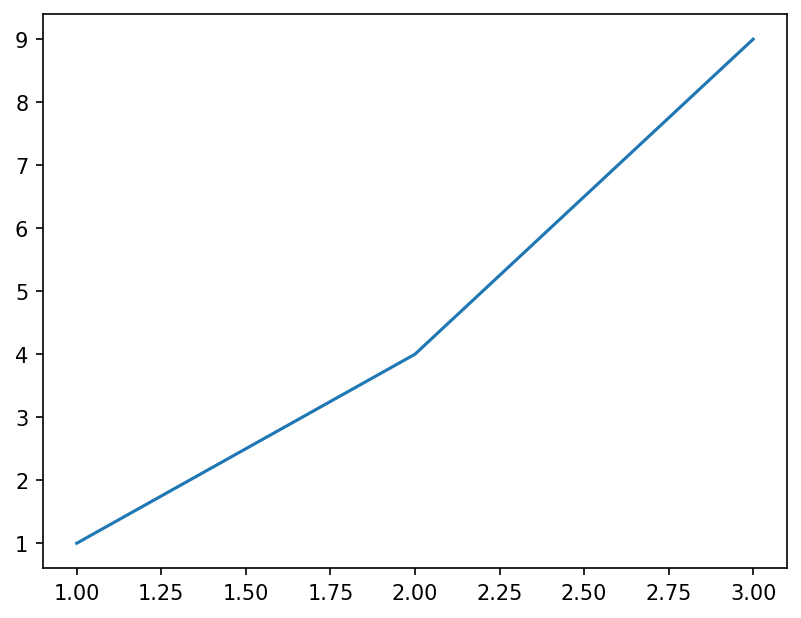
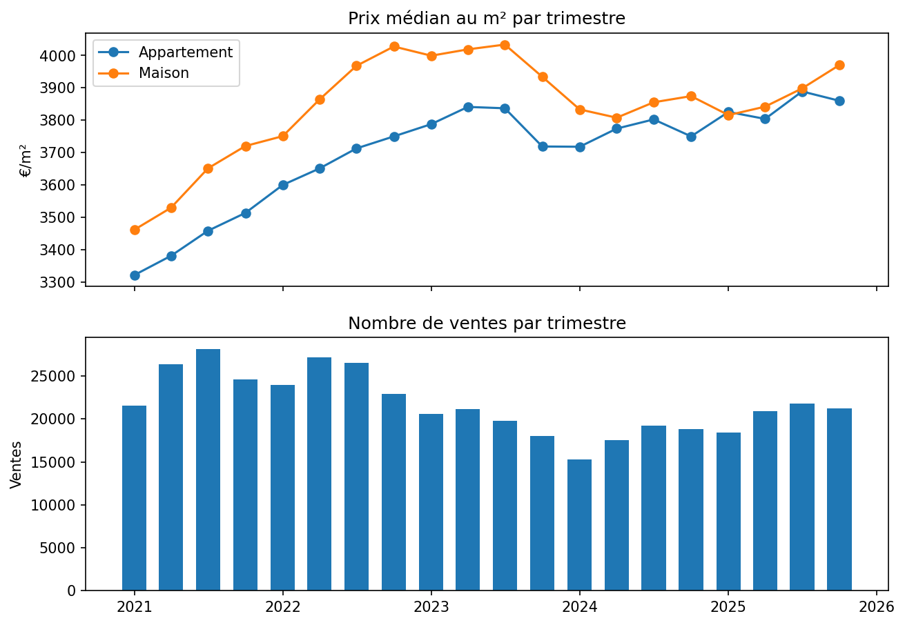
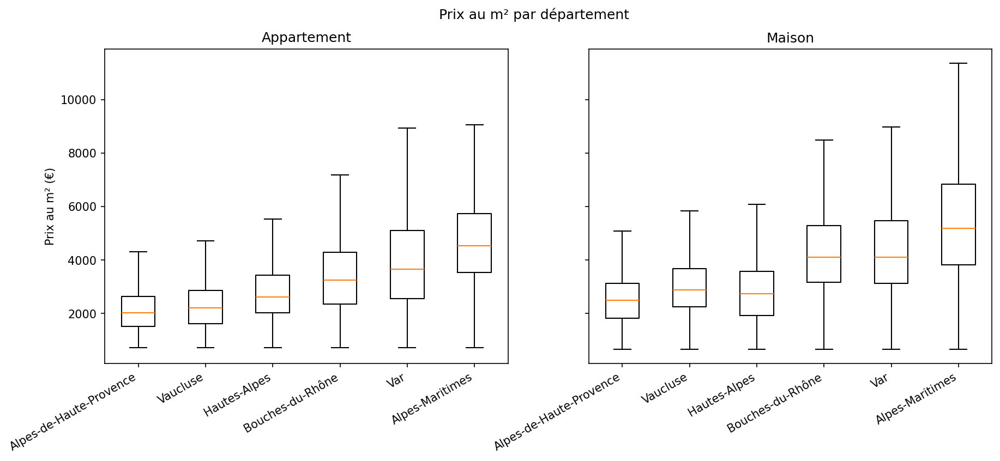
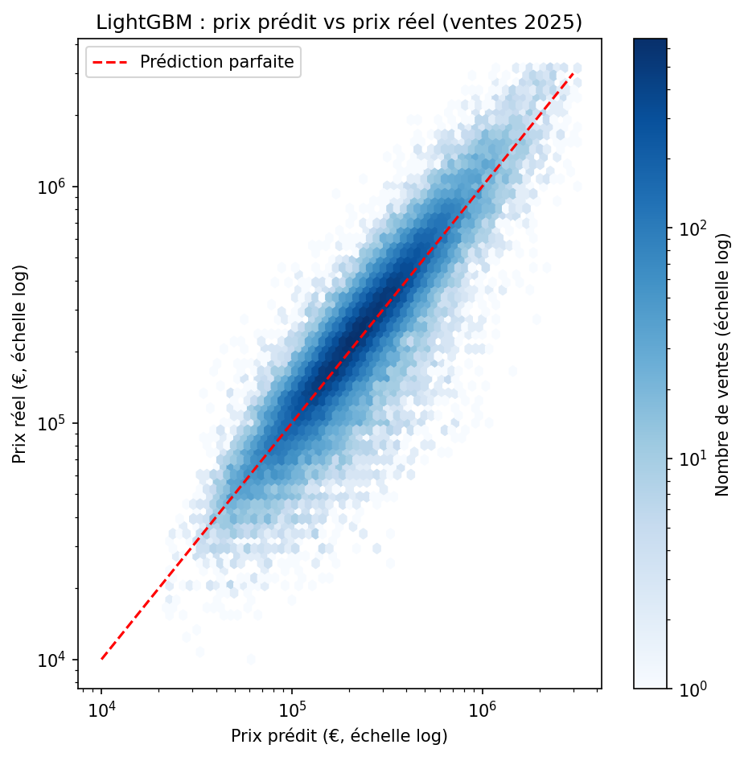
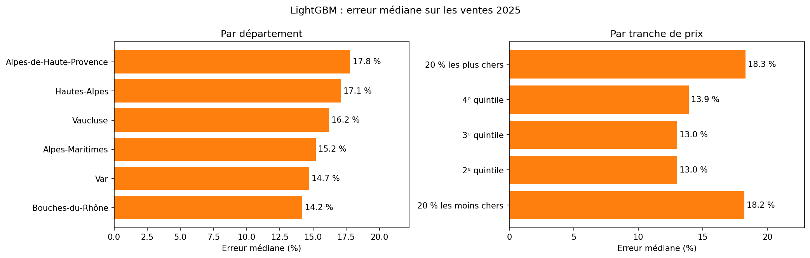

# 🏠 Estimateur de prix immobilier en PACA

Prédire le prix de vente d'un appartement ou d'une maison en Provence-Alpes-Côte d'Azur à partir de ses caractéristiques et de sa localisation, en s'entraînant sur **toutes les ventes réellement enregistrées par l'État** entre 2021 et 2025 (données DVF).

**Résultat :** sur les 82 335 ventes de 2025, jamais vues pendant l'entraînement, le modèle LightGBM estime le prix avec une **erreur médiane de 14,9 %**, et 63 % des estimations tombent à ±20 % du prix réel.



---

## Sommaire

1. [Les données](#1-les-données)
2. [Nettoyage : les pièges de DVF](#2-nettoyage--les-pièges-de-dvf)
3. [Analyse exploratoire](#3-analyse-exploratoire)
4. [Feature engineering](#4-feature-engineering)
5. [Modélisation et résultats](#5-modélisation-et-résultats)
6. [Limites et pistes d'amélioration](#6-limites-et-pistes-damélioration)
7. [Reproduire le projet](#7-reproduire-le-projet)

---

## 1. Les données

**Source :** [Demandes de valeurs foncières géolocalisées](https://www.data.gouv.fr/fr/datasets/demandes-de-valeurs-foncieres-geolocalisees/) (DGFiP, Etalab), publiées en open data sur data.gouv.fr.

- **Périmètre :** les 6 départements de PACA (04, 05, 06, 13, 83, 84)
- **Période :** 2021 à 2025 (les années disponibles en ligne)
- **Volume :** 1 720 509 lignes brutes, 40 colonnes

Chaque ligne décrit un élément d'une vente : prix, date, adresse, type de bien, surface, nombre de pièces, terrain, coordonnées GPS.

## 2. Nettoyage : les pièges de DVF

📓 [`02_nettoyage.ipynb`](notebooks/02_nettoyage.ipynb)

DVF ne contient pas « une ligne par vente » mais **une ligne par élément vendu** (logement, cave, parking, parcelle), avec **le prix total répété sur chaque ligne**. Utilisées telles quelles, ces lignes comptent plusieurs fois le même prix et attribuent à une cave le prix d'un appartement entier.

Le nettoyage ramène les données à **une ligne par vente d'un seul logement** :

| Étape | Nombre |
|---|---:|
| Lignes brutes | 1 720 509 |
| Lignes de type « Vente » (hors VEFA, échanges, adjudications…) | 1 576 006 |
| Ventes uniques | 630 880 |
| Ventes avec au moins un bâtiment | 560 698 |
| Ventes d'un seul logement (maison ou appartement, avec ou sans dépendances) | 450 363 |
| **Après suppression des valeurs aberrantes** | **434 089** |

Deux pièges principaux sont traités : les **ventes multi-lignes** (prix répété) et les **biens dupliqués** (une même maison répétée pour chaque nature de culture de son terrain).

## 3. Analyse exploratoire

📓 [`03_analyse_exploratoire.ipynb`](notebooks/03_analyse_exploratoire.ipynb)

- **La localisation domine.** Le littoral (Côte d'Azur, presqu'île de Saint-Tropez, Cassis), Aix-en-Provence et le Luberon sont les zones les plus chères. L'arrière-pays alpin est jusqu'à **sept fois moins cher** : 10 400 €/m² à Ramatuelle contre 1 400 €/m² à Tende.
- **Le marché a connu trois phases :** une hausse de 16 % entre 2021 et mi-2023, une baisse et un effondrement du nombre de ventes avec la remontée des taux (de 28 000 à 15 000 ventes par trimestre), puis une reprise en 2025.

| | |
|---|---|
|  |  |

## 4. Feature engineering

📓 [`04_features.ipynb`](notebooks/04_features.ipynb)

19 variables, regroupées en 4 familles :

- **Le bien :** surface (log), pièces, surface par pièce, terrain, dépendances, maison ou appartement
- **Le temps :** mois écoulés depuis 2021 (tendance du marché), mois de l'année (saisonnalité)
- **La géographie :** coordonnées GPS, **distance à la mer** (calculée à partir d'un tracé du littoral), distance aux grandes villes
- **Le voisinage :** **prix au m² médian des 20 ventes les plus proches** et distance à la 20ᵉ voisine

Le prix des voisines est la variable la plus puissante, et aussi la plus exposée à la **fuite de données**. Pour l'éviter :

- la vente elle-même est exclue de ses propres voisines (*leave-one-out*) ;
- les voisines sont toujours cherchées parmi les ventes d'entraînement (2021-2024), jamais parmi les ventes de test (2025).

## 5. Modélisation et résultats

📓 [`05_modelisation.ipynb`](notebooks/05_modelisation.ipynb)

- **Cible :** logarithme du prix de vente
- **Découpage temporel :** entraînement sur 2021-2024 (351 754 ventes), test sur 2025 (82 335 ventes), pour simuler une estimation de ventes futures
- **Choix du nombre d'arbres de LightGBM** par *early stopping* sur 2024, sans jamais utiliser les données de test

| Modèle | Erreur médiane | Erreur médiane (€) | À ±10 % | À ±20 % |
|---|---:|---:|---:|---:|
| Baseline : prix des voisines × surface | 16,9 % | 36 337 € | 31,2 % | 57,2 % |
| Régression linéaire | 15,8 % | 34 508 € | 33,8 % | 59,7 % |
| Random Forest | 15,1 % | 32 618 € | 34,9 % | 62,1 % |
| **LightGBM** | **14,9 %** | **32 467 €** | **34,8 %** | **62,7 %** |

| | |
|---|---|
|  |  |

**Où le modèle se trompe :** il est plus fiable pour les appartements (14,2 %) que pour les maisons (16,6 %), dans les départements denses (Bouches-du-Rhône : 14,2 %) que ruraux (Alpes-de-Haute-Provence : 17,8 %), et pour les biens de prix moyen (13 %) que pour les extrêmes (18 %), où il tend à ramener ses estimations vers la moyenne.

## 6. Limites et pistes d'amélioration

**Limites :**

- **Informations absentes de DVF :** état du logement, étage, vue, piscine, performance énergétique. C'est la principale source d'erreur.
- **Périmètre :** logements anciens uniquement (hors VEFA), hors grand luxe (1 % des prix au m² les plus élevés exclus).
- **Littoral simplifié :** la distance à la mer repose sur un tracé d'environ 70 points (précision de l'ordre du kilomètre).

**Pistes :**

1. Croiser avec le **DPE** (ADEME) pour intégrer la performance énergétique
2. Corriger le prix des voisines de **l'évolution du marché**
3. Chercher des voisines de **surface comparable**
4. Optimiser les hyperparamètres par **validation croisée temporelle**
5. Expliquer les prédictions avec **SHAP** et déployer une **application d'estimation**

## 7. Reproduire le projet

```bash
git clone https://github.com/salwahmch/estimateur-immo-dvf.git
cd estimateur-immo-dvf
python -m venv .venv
.venv\Scripts\activate          # Windows (source .venv/bin/activate sous macOS/Linux)
pip install -r requirements.txt
python src/download_data.py     # télécharge les données DVF de PACA (environ 45 Mo)
```

Exécuter ensuite les notebooks dans l'ordre, de `01` à `05`.

```
estimateur-immo-dvf/
├── src/download_data.py      # téléchargement des données
├── notebooks/
│   ├── 01_exploration.ipynb
│   ├── 02_nettoyage.ipynb
│   ├── 03_analyse_exploratoire.ipynb
│   ├── 04_features.ipynb
│   └── 05_modelisation.ipynb
├── figures/                  # graphiques générés par les notebooks
└── requirements.txt
```

**Stack :** Python, pandas, scikit-learn, LightGBM, matplotlib
